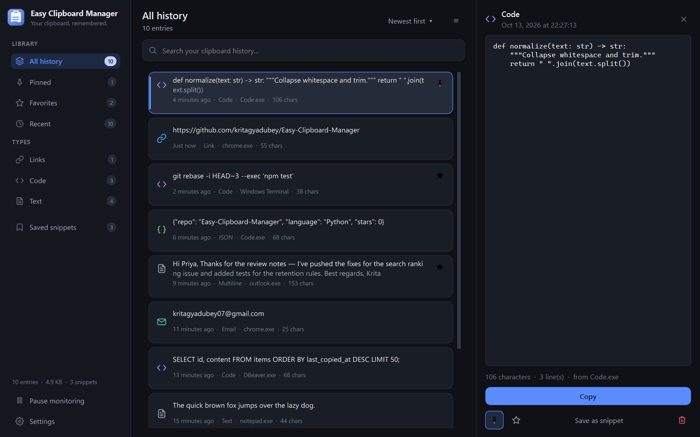
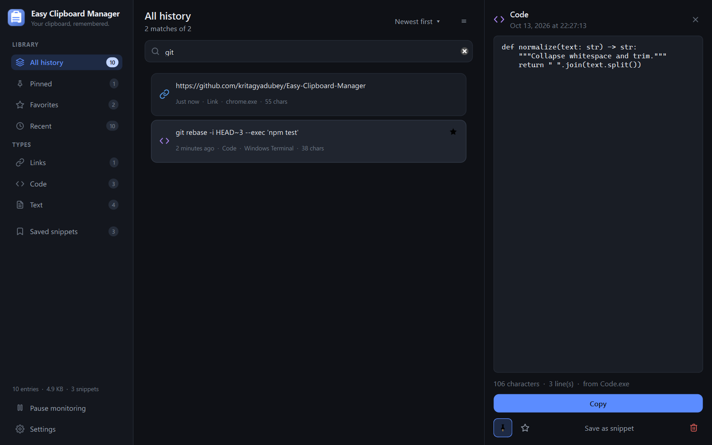
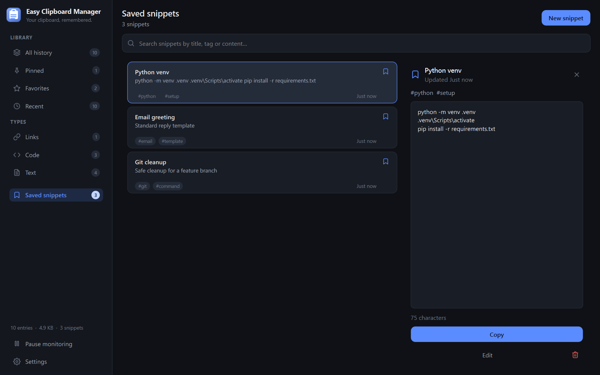
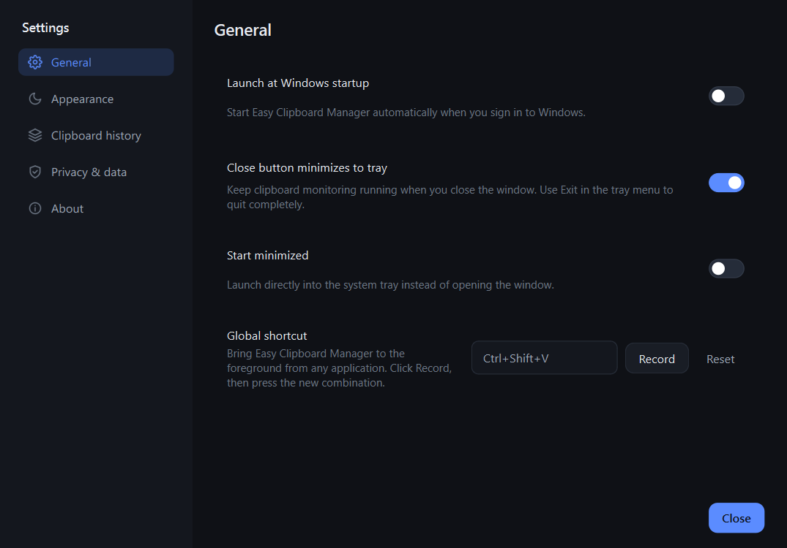
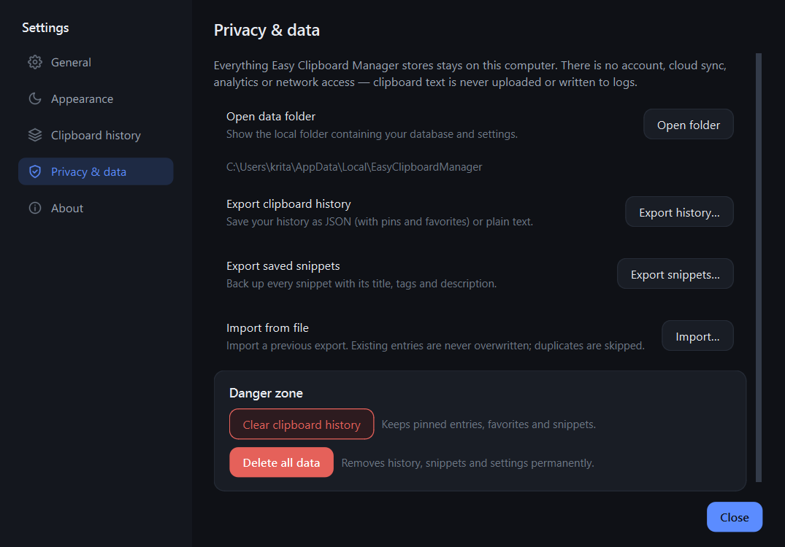
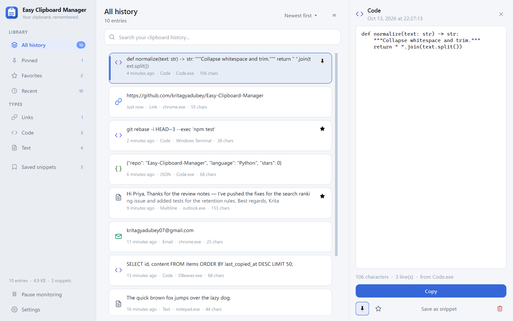
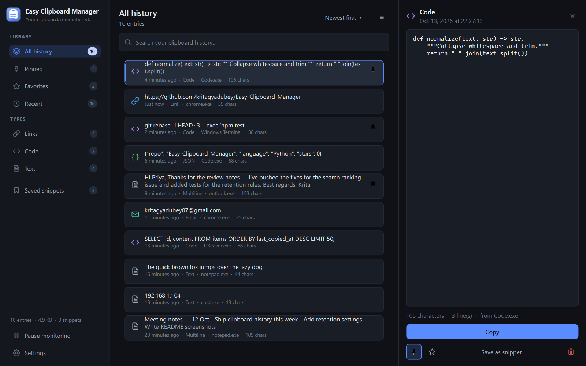

# Easy Clipboard Manager

**Your clipboard, remembered.**

A lightweight, privacy-first clipboard history manager for Windows. Everything is stored
locally on your machine — no account, no cloud sync, no telemetry, and clipboard text is
never written to logs.

Built with Python and PySide6 (Qt), with a dark-first interface, a matching light theme,
a system tray presence, and a global hotkey that needs no admin rights.



---

## Features

**Clipboard history**
- Watches the Windows clipboard and captures copied text automatically, with the source
  application recorded for each entry.
- Automatic content classification: text, multiline, link, email, number, JSON, code.
- Duplicate handling (`refresh` position vs. `ignore`), a configurable maximum item count
  (25–10,000), and a retention period (Keep everything, 1 day … 1 year).
- Pinned and favourited entries are protected from trimming and from "Clear history".

**Search & navigation**
- Instant search with a 140 ms debounce across the full history.
- Sidebar sections: All history, Pinned, Favorites, Recent, plus type filters
  (Links, Code, Text) and saved snippets.
- Sort by newest, oldest, or most used.

**Snippets**
- Save frequently used text with a title, description, and tags.
- Search snippets by title, tag, or content; copy or edit them in one click.

**Keyboard-first**
| Key | Action |
| --- | --- |
| `Ctrl+F` / `Ctrl+L` | Focus search |
| `↑` `↓` | Move through the list |
| `Enter` | Copy the selected entry |
| `Ctrl+C` | Copy the selected entry |
| `Ctrl+P` | Pin / unpin the selected entry |
| `Delete` / `Backspace` | Delete the selected entry |
| `Esc` | Close preview / clear search |
| `Ctrl+N` | New snippet |
| `Ctrl+,` | Open settings |

**Global shortcut**
- Default `Ctrl+Shift+V` brings the window forward from any application.
- Re-record it from Settings → General (the capture dialog requires at least one
  modifier), or reset it to the default. Registration failures are reported honestly in
  the dialog rather than silently ignored.

**System tray**
- Close button minimizes to tray (configurable) so monitoring keeps running.
- Tray menu: open the app, pause/resume monitoring, jump to pinned items or snippets,
  clear history, settings, exit.
- Optional launch at Windows startup (off by default) and optional start-minimized.

**Settings** — every switch is functional and persisted to `settings.json`:
General (startup, tray, hotkey), Appearance (theme dark/light/system, density
comfortable/compact), Clipboard history (monitoring, max items, retention, duplicates,
app exclusions), Privacy & data (open folder, export/import, clear, delete all data).

**Import / export**
- Export history and snippets to JSON (keeps pins, favorites, and tags) or plain text.
- Import accepts both JSON and TXT. Imports are **additive only** — existing entries are
  never overwritten, duplicates are skipped, and malformed files are reported instead of
  being half-applied.

**Privacy**
- All data lives in a single per-user folder: `%LOCALAPPDATA%\EasyClipboardManager`
  (`history.db`, `settings.json`, `app.log`).
- SQLite (WAL mode) for history, JSON for settings. No network code paths at all.
- Logging records metadata only — a test suite guards against clipboard contents
  reaching the log.
- Application exclusion rules let you skip specific source apps (best effort — see
  [Limitations](#limitations)).

## Screenshots

| | |
| --- | --- |
|  |  |
|  |  |
|  |  |

## Requirements

- Windows 10 or later
- Python 3.10+ (only when running from source)

## Install & run

From a source checkout:

```powershell
git clone https://github.com/kritagyadubey/Easy-Clipboard-Manager.git
cd Easy-Clipboard-Manager
python -m venv .venv
.\.venv\Scripts\activate
pip install -r requirements.txt
python run.py
```

Useful flags:

```powershell
python run.py --background   # start hidden in the tray
python run.py --verbose      # debug-level diagnostics (still no clipboard contents)
```

Only one instance runs at a time; activating the shortcut or tray icon of a second
launch brings the existing window forward.

### Build a standalone .exe

```powershell
pip install -r requirements-dev.txt
packaging\build_windows.bat
```

The result is `dist\EasyClipboardManager\EasyClipboardManager.exe` (a onedir build —
keep the whole folder together).

## Development

```powershell
pip install -r requirements-dev.txt

# Tests (offscreen Qt — no display needed)
$env:QT_QPA_PLATFORM='offscreen'; python -m pytest tests

# Lint
python -m pyflakes easy_clipboard scripts tests run.py

# Regenerate the README screenshots (uses the real Windows platform for fonts)
python scripts\capture_screenshots.py
```

The test suite covers content classification, storage and migrations, the history
service, settings persistence, import/export portability, log privacy, hotkey parsing,
and UI smoke tests (including settings write-through and density switching).

## Project layout

```
easy_clipboard/
  app.py            # composition root: wiring, single instance, tray, hotkey
  history.py        # capture rules, trimming, queries, snippets
  storage.py        # SQLite (WAL) persistence
  settings.py       # JSON settings store + validation
  portability.py    # JSON/TXT export and additive import
  clipboard/        # clipboard monitoring
  windows/          # Win32 helpers: hotkey, window info, single instance
  ui/               # theme, widgets, views, dialogs
scripts/            # screenshot generator
packaging/          # PyInstaller spec + build script
tests/              # pytest suite
docs/screenshots/   # images used in this README
```

## Data & privacy details

- **Location:** `%LOCALAPPDATA%\EasyClipboardManager`
- **Contents:** `history.db` (clipboard entries and snippets), `settings.json`
  (preferences and window geometry), `app.log` (rotating, metadata only).
- **Network:** none. The app makes no outbound connections and bundles no analytics.
- **Deletion:** Settings → Privacy & data → *Delete all data* removes history, snippets,
  and settings. *Clear clipboard history* keeps pinned entries, favorites, and snippets.

## Troubleshooting

| Problem | What to try |
| --- | --- |
| The global shortcut does nothing | Another program may own `Ctrl+Shift+V`. Record a different combination in Settings → General — the dialog reports registration failures. |
| Nothing is being captured | Check the pause state in the tray menu or sidebar, and review excluded apps under Settings → Clipboard history. |
| Startup launch does not work | *Launch at Windows startup* is opt-in and registers the current user only (no admin). Some hardened environments block registry Run keys. |
| The tray icon is missing | Windows can hide overflow icons; drag it onto the taskbar. |
| Settings look corrupted | The app validates and normalizes `settings.json` on load and falls back to defaults for invalid values instead of crashing. |
| The database is locked | Only one instance runs at a time. If a previous process is stuck, end it in Task Manager and restart. |

Logs are at `%LOCALAPPDATA%\EasyClipboardManager\app.log`.

## Limitations

Stated honestly so nothing here is mistaken for a guarantee:

- **Verified on this machine:** the pytest suite (143 tests) passes, `pyflakes` is clean,
  all screenshots in this README are renders of the running application, and the
  PyInstaller build produces an executable that starts and creates its data folder.
- **Not verified here:** automated tests run with offscreen Qt, so the system tray,
  global hotkey registration, clipboard polling against real applications, and
  launch-at-startup are exercised only manually — Windows-specific integration is not
  covered by CI.
- **App exclusion rules are best effort.** The source app is identified from the
  foreground window at capture time. If the clipboard is set programmatically, or the
  foreground window changes before the poll fires, attribution can be wrong or missing.
- **Text only.** Images, files, and other non-text clipboard formats are not captured.
- Screenshots are rendered at a 1.25 device pixel ratio; text may look slightly
  different on other displays.

## License

[MIT](LICENSE)
